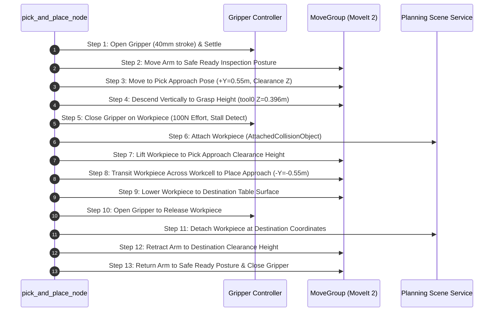

# `lexium_cobot_l18s_pick_and_place`

Complete industrial Table-to-Table Pick and Place application for the **Schneider Electric Lexium Cobot L18S** robot arm in ROS 2 Jazzy.

---

## Overview

This package provides an end-to-end industrial pick-and-place workcell with:
- **Dual Table Workcell**: Symmetrical source (Pick Table at $+Y$) and destination (Place Table at $-Y$) workbenches with robot base mounting pedestal.
- **Gazebo Harmonic World**: High-fidelity physics simulation (`pick_and_place_cell.sdf`) featuring realistic lighting, workpiece inertial and high-friction contact mechanics.
- **MoveIt 2 Planning Scene Synchronization**: Automated injection of tables, obstacles, and dynamic workpiece attachment (`AttachedCollisionObject`) on grasp and detachment on release.
- **Robust Motion State Machine**: 13-stage deterministic pick, lift, transit, place, release, and safe return cycle with Pilz Industrial Motion Planner / OMPL.
- **Multi-Backend Execution**: Seamless execution in both **Mock Hardware** (`mode:=mock`) and **Gazebo Harmonic Simulation** (`mode:=sim`).

https://github.com/user-attachments/assets/b81ddbc6-6508-448d-9484-2ec695c9036f

> **Autonomous Pick-and-Place Demonstration**: Live Gazebo Harmonic physics simulation featuring dynamic collision object tracking, vertical descent grasp with physical stall detection, table-to-table transit, and placement.

---

## Package Structure

```text
lexium_cobot_l18s_pick_and_place/
├── CMakeLists.txt
├── package.xml
├── README.md
├── config/
│   ├── scene_objects.yaml           # Planning scene geometries & coordinates
│   └── pick_and_place_params.yaml    # Speeds, offsets, tolerances, waypoints
├── worlds/
│   └── pick_and_place_cell.sdf      # Gazebo Harmonic dual-table workcell
├── launch/
│   ├── pick_and_place_cell.launch.py # Workcell bringup (MoveIt + RViz + Controllers)
│   └── pick_and_place_demo.launch.py # Single-command bringup + auto task execution
├── scripts/
│   └── pick_and_place_node.py       # Main MoveIt 2 pick & place orchestrator node
└── rviz/
    └── pick_and_place.rviz          # Tailored RViz2 layout with planning scene
```

---

## Quick Start & Usage

### 1. Single-Command Automated Demonstration (Mock Mode)

To launch the entire workcell (Robot + Parallel Gripper + MoveIt 2 + RViz) and automatically execute the pick-and-place cycle:

```bash
ros2 launch lexium_cobot_l18s_pick_and_place pick_and_place_demo.launch.py
```

### 2. Manual Two-Step Execution (Sim / Mock)

#### Step 1: Launch the Robotic Workcell
```bash
# Offline Mock Hardware + MoveIt 2 + RViz:
ros2 launch lexium_cobot_l18s_pick_and_place pick_and_place_cell.launch.py mode:=mock

# Gazebo Harmonic Physics Simulation + MoveIt 2 + RViz:
ros2 launch lexium_cobot_l18s_pick_and_place pick_and_place_cell.launch.py mode:=sim
```

#### Step 2: Run the Pick and Place Task Node
```bash
# Run a single pick-and-place cycle:
ros2 run lexium_cobot_l18s_pick_and_place pick_and_place_node.py

# Run continuous automated pick-and-place loop:
ros2 run lexium_cobot_l18s_pick_and_place pick_and_place_node.py --continuous

# Run a specific number of cycles (e.g., 5 cycles):
ros2 run lexium_cobot_l18s_pick_and_place pick_and_place_node.py --cycles 5
```

---

## Pick & Place State Machine Sequence



### Sequence Breakdown
1. **INIT & CONNECT**: Establishes action client connections to `/move_action`, `/gripper_controller/gripper_cmd`, and `/apply_planning_scene`.
2. **SETUP SCENE**: Injects Pick Table ($Z_{\text{base}}=0.10\,\text{m}$), Place Table ($Z_{\text{base}}=0.10\,\text{m}$), and Workpiece ($Z_{\text{base}}=0.29\,\text{m}$) into MoveIt Planning Scene with Allowed Collision Matrix (ACM) permissions.
3. **SAFE READY**: Commands arm to central inspection posture facing between both tables.
4. **OPEN GRIPPER**: Commands $40\,\text{mm}$ full parallel stroke.
5. **PICK APPROACH**: Translates horizontally above the Pick Table at $+Y=0.55\,\text{m}$, clearance $Z_{\text{tool0}}=0.56\,\text{m}$.
6. **PICK DESCEND**: Straight vertical descent normal to table surface until `tool0` reaches $Z_{\text{base}}=0.396\,\text{m}$. Fingertips clear table by $+22.0\,\text{mm}$ and rubber contact pads flank the workpiece center of mass.
7. **GRASP WORKPIECE**: Actuates gripper with $100\,\text{N}$ effort. Detects physical contact via `stalled: true` and holds firmly.
8. **ATTACH OBJECT**: Registers workpiece as `AttachedCollisionObject` on `tool0` in MoveIt Planning Scene.
9. **PICK RETREAT**: Lifts workpiece vertically back to clearance height ($Z_{\text{tool0}}=0.56\,\text{m}$).
10. **TRANSIT**: Collision-free motion across workcell to Destination Table approach ($-Y=-0.55\,\text{m}$).
11. **PLACE DESCEND**: Lowers workpiece onto destination table surface ($Z_{\text{tool0}}=0.396\,\text{m}$).
12. **RELEASE WORKPIECE**: Opens gripper fully ($40\,\text{mm}$).
13. **DETACH OBJECT**: Detaches workpiece in Planning Scene and adds it as a static obstacle at destination coordinates.
14. **PLACE RETREAT**: Retracts arm vertically to clearance height.
15. **SAFE HOME/READY**: Returns arm to Safe Ready posture and closes gripper for standby.

---

## Interfaces & Topics

- **Action Servers**:
  - `/move_action` (`moveit_msgs/action/MoveGroup`): Programmatic trajectory planning and execution.
  - `/gripper_controller/gripper_cmd` (`control_msgs/action/ParallelGripperCommand`): Gripper actuation.
- **Services**:
  - `/apply_planning_scene` (`moveit_msgs/srv/ApplyPlanningScene`): Dynamic collision object & attachment management.
- **Topics**:
  - `/joint_states` (`sensor_msgs/msg/JointState`): Real-time joint feedback.
  - `/monitored_planning_scene` (`moveit_msgs/msg/PlanningScene`): Live planning scene state.
